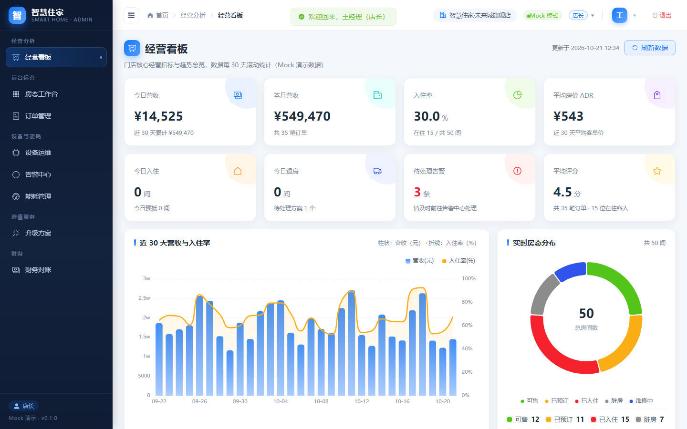
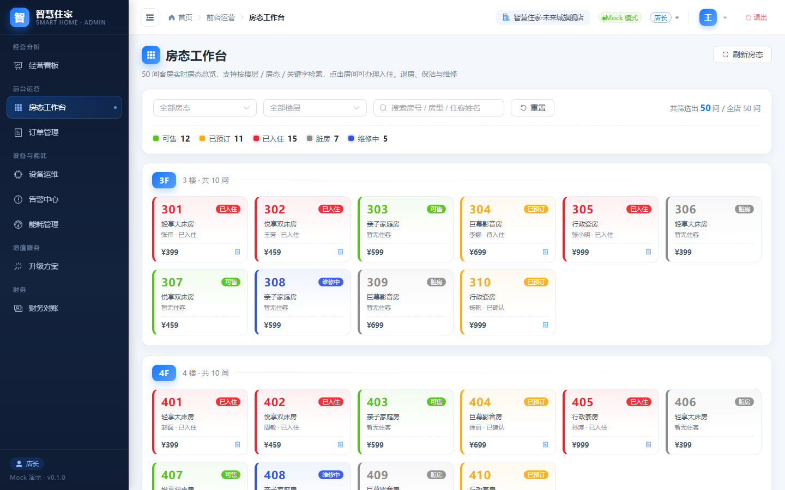
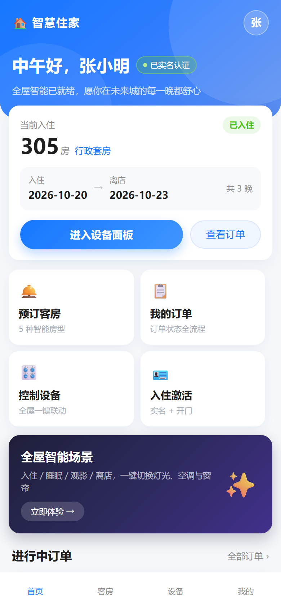
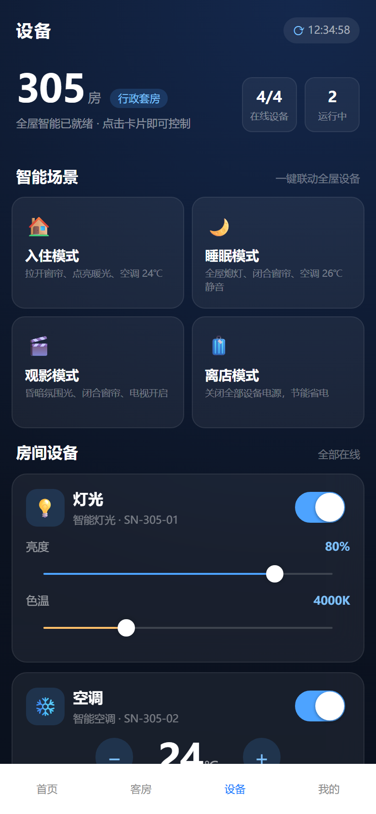

# Smart Home Hotel · 智慧住家

> 覆盖酒店 / 公寓 / 娱乐场所的「全链路智能家居」平台。
> 本仓库是 MVP 阶段的可运行全栈骨架：**C 端顾客端 + B 端管理后台 + 共享业务包 + Go 后端骨架**，全部业务数据使用 Mock，可一键切换真实接口。

---

## 一、当前阶段说明（MVP / Mock）

- 考核指标：「能用就行」——页面视觉、路由跳转、订单状态机、房态图、设备控制面板交互全部可跑通；
- 数据：`@smart-home/api` 内置 Mock 数据 + Memory 数据库，字段严格对齐真实业务标准；
- 技术栈：前端 **纯 JavaScript（无 TypeScript）**；C 端 uni-app(Vue3)，B 端 Vue3 + Element Plus + ECharts；
- 后端：Go(Gin) 分层骨架已就位，接口与前端 Mock 同构，后期直接联调。

## 二、目录结构

```text
Smart Home Hotel/
├─ docs/
│  ├─ architecture.md      # 架构、数据模型、状态机、权限、约定
│  └─ api-contract.md      # C/B 共用 API 契约（Mock 与真实后端同构）
├─ frontend/               # pnpm workspace Monorepo
│  ├─ packages/
│  │  ├─ shared-utils/     # 常量 / 状态机 / RBAC / 格式化 / 校验 / 存储
│  │  ├─ shared-api/       # axios 封装 + Mock 拦截 + 9 大业务 API
│  │  └─ shared-stores/    # Pinia 9 个业务模块
│  └─ apps/
│     ├─ customer/         # C 端 uni-app（H5 / 小程序 / APP）
│     └─ admin/            # B 端管理后台（Element Plus + ECharts）
└─ backend/                # Go(Gin) 后端骨架
```

## 三、快速开始

前置：Node.js ≥ 22.12，pnpm ≥ 10（或使用 Corepack）。

```bash
cd "Smart Home Hotel/frontend"
pnpm install

# C 端顾客端（http://localhost:5173）
pnpm dev:customer

# B 端管理后台（http://localhost:5174）
pnpm dev:admin

# 生产构建
pnpm build:customer   # 产物 apps/customer/dist/build/h5
pnpm build:admin      # 产物 apps/admin/dist
```

### 演示账号

| 端 | 账号 | 说明 |
| :--- | :--- | :--- |
| C 端 | 任意 11 位手机号（推荐 `13800138000`） | 验证码固定 `1234`；该账号已实名并入住 305 房，登录即可体验设备控制 |
| B 端 | 登录页选择角色卡片：店长 / 前台 / 财务 / 运维 | 免密 Mock 登录，可随时在顶栏切换角色演示 RBAC |

## 四、界面预览

| B 端 · 经营看板 | B 端 · 房态工作台 |
| :---: | :---: |
|  |  |
| **C 端 · 首页** | **C 端 · 设备控制面板** |
|  |  |

> 截图由 Edge headless 对生产构建产物实拍，见 `docs/screenshots/`。

## 五、核心能力清单

**C 端**：手机号验证码登录、房型房态查询、下单支付、实名认证（OCR Mock）、入住激活开门、设备控制面板（灯光/空调/窗帘/电视）、场景一键切换（入住/睡眠/观影/离店）、订单状态机（支付/取消/退款/入住/退房/评价）。

**B 端**：经营看板（营收/入住率/ADR ECharts）、50 间可视化房态图（前台入住/退房/保洁）、订单管理（状态流转）、设备运维（远程控制/自检）、告警中心（离线/SOS）、能耗管理、住宿升级方案生成与审批、财务对账发票。

**共享层**：统一 axios 请求封装（Mock 开关、token 注入、错误归一）、订单/房态状态机单点维护、RBAC 权限与动态菜单、Pinia 全量业务模块。

## 六、核心数据模型（摘要）

| 模型 | 关键字段 |
| :--- | :--- |
| users | `id, phone, real_name, id_card, status`（+ role、current_room_id） |
| rooms | `id, store_id, room_no, type_name, status`（+ price、guest、current_order_id） |
| orders | `id, user_id, room_id, amount, status, check_in_time, check_out_time`（+ 状态时间戳、间夜、退款原因） |
| devices | `id, room_id, sn, type, online_status, properties` |
| scenes | `id, name, actions: [{ device_type, property, value }]` |
| plans / alarms / invoices / dashboard | 升级方案、告警、发票、看板指标与趋势（详见 `docs/architecture.md`） |

**状态机**：订单 `待支付 → 已支付/已确认 → 待入住 → 已入住 → 已完成 → 已评价`（含取消、退款中、已退款分支）；房态 `可售 → 已预订 → 已入住 → 脏房 → 维修中 → 可售`。

## 七、Mock 与真实后端切换

```js
// 应用入口 main.js
initHttp({
  baseURL: import.meta.env.VITE_API_BASE_URL, // 真实后端时改为 https://api.xxx.com
  mock: import.meta.env.VITE_USE_MOCK !== 'false'
})
```

1. `.env` 中 `VITE_USE_MOCK=false` 并配置真实 `VITE_API_BASE_URL`；
2. 后端按 `docs/api-contract.md` 提供同路径接口（`backend/` 骨架已对齐）；
3. 前端页面、Pinia、组件代码**零改动**。

> C 端 uni-app 构建会优先读取 `.env.[mode]` 文件，覆盖 Mock 开关请修改 `.env.production` 或新增 `.env.production.local`；
> B 端 Vite 构建也支持直接传进程环境变量（`VITE_USE_MOCK=false VITE_API_BASE_URL=... pnpm build:admin`）。

## 八、后端骨架

```bash
cd backend
go mod tidy
go run ./cmd/server   # 默认 :8080，接口前缀 /api
```

分层：`cmd → router → handler → service → store`；中间件：CORS / 日志 / Bearer 鉴权 / RBAC；`internal/iot` 预留 EMQX(MQTT) 接入点。
详见 `backend/README.md`。

## 九、交付验证（本次骨架生成时实际执行）

| 验证项 | 结果 |
| :--- | :--- |
| pnpm workspace 安装 | ✅ 6 个 workspace 项目，install exit 0 |
| shared-api Mock 冒烟（Node，23 项断言） | ✅ 登录/鉴权、房态、订单状态机全链路、设备属性、场景、看板、告警、方案审批、发票 |
| C 端 `build:h5` | ✅ `DONE Build complete.`（uni-app 3 / Vue3） |
| B 端 `build` | ✅ Vite production build |
| 后端 `gofmt -l` / `go build ./...` / `go vet ./...` | ✅ 全部通过（Go 1.27.3 工具链） |
| 后端真实进程接口冒烟（75 项）+ RBAC | ✅ 49 个契约接口、401/403/4031/5003/8004 等错误码符合契约 |
| 浏览器 E2E（Edge headless 对构建产物） | ✅ 16/16 检查通过：登录、看板 3 图表、50 间房态图、订单、方案、角色切换菜单收敛、C 端登录/首页/设备面板/订单列表 |
| 关闭 Mock 直连 Go 后端（`VITE_USE_MOCK=false`） | ✅ B 端登录/看板/房态/订单、C 端登录/设备面板/场景执行均命中 `:8080` 真实接口 |
| 页面截图 | ✅ `docs/screenshots/`（10 张实拍） |
| 纯 JavaScript 检查 | ✅ 无 `.ts` / `tsconfig` 文件 |

> 已知非阻断项：
> 1. uni-app H5 会在控制台输出一次 `Hydration completed but contains mismatches`（DCloud 已知问题，[相关反馈](https://ask.dcloud.net.cn/question/177517)），不影响客户端渲染与交互；
> 2. uni-app H5 构建产物会自动注入阿里云实人认证外链 SDK（平台默认行为），离线环境异步加载失败不影响演示；
> 3. 后端拉取依赖时如遇 `proxy.golang.org` 超时，可使用 `GOPROXY=https://goproxy.cn,direct`。

## 十、文档

- [架构与数据模型](docs/architecture.md)
- [前后端 API 契约](docs/api-contract.md)
- [后端骨架说明](backend/README.md)
